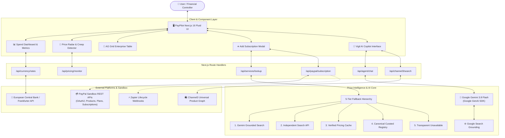

# PayPilot 🚀

<div align="center">


[](https://developer.paypal.com)
[](https://ai.google.dev)
[](https://nextjs.org)
[](https://react.dev)
[](https://www.typescriptlang.org)
[](https://tailwindcss.com)
[](https://www.ag-grid.com)
[](https://trychannel3.com)
[](LICENSE)

<p align="center">
  <strong>Autonomous subscription management, price intelligence, and spend protection engine powered by PayPal and Google Gemini.</strong>
</p>

[Key Features](#-key-features) • [System Architecture](#-system-architecture) • [Vigil AI Copilot](#-vigil-ai-copilot) • [Price Intelligence Engine](#-price-intelligence-engine) • [PayPal Integration](#-paypal-sandbox-integration) • [Getting Started](#-getting-started) • [API Reference](#-api-reference) • [Test Suite](#-verification--test-suite)

</div>

---

## 💡 Overview

In today's digital economy, individuals and businesses manage dozens of software subscriptions, cloud services, and entertainment memberships. This convenience creates widespread **subscription leakage, unannounced price hikes, and forgotten recurring drain**.

**PayPilot** unifies **PayPal's global recurring subscription infrastructure** with **Google Gemini agentic AI** to create an intelligent financial copilot. Rather than passively listing recurring bills, PayPilot autonomously audits portfolio spend, verifies live subscription prices on the web, detects silent price creep, suggests perpetual software alternatives, and stages programmatic PayPal billing modifications with one-click user authorization.

---

## ⚡ Key Features

| Capability | Description |
| :--- | :--- |
| 🛡️ **Vigil AI Financial Guardian** | Autonomous agent powered by **Gemini 3.8 Flash** with live Google Search Grounding and structured tool calling for portfolio audits, redundancy detection, and safe human-in-the-loop action staging. |
| 🔍 **Live Price Intelligence Engine** | 5-tier fallback discovery system that cross-references live web pricing, introductory rate expirations, student discounts, and regional plan structures. |
| ⚡ **Price Radar & Creep Detection** | On-demand web pricing audit that scans active subscriptions, models monthly and annual budget impacts ($\Delta \text{Cost}$), and flags stealth price hikes. |
| 💳 **PayPal Sandbox Lifecycle** | Programmatic product catalog generation, custom billing plans (monthly, quarterly, annual), hosted approval workflows, live status synchronization, immediate suspensions, and permanent cancellations. |
| 🌍 **75+ Multi-Currency Engine** | Real-time exchange rate conversions powered by the European Central Bank (ECB / Frankfurter API) with immutable baseline anchoring to eliminate double-conversion rounding drift. |
| 📈 **30-Day Cash Flow Forecasting** | Dynamic Recharts visualization charting scheduled renewal cliffs, run-rate expenditures, and upcoming billing milestones across active agreements. |
| 📊 **AG Grid Power Audit** | High-density enterprise data grid supporting multi-column sorting, column filtering, search filtering, and one-click CSV ledger export. |
| 🛍️ **Channel3 Perpetual Deals** | Direct integration with the Channel3 Universal Product Graph to discover verified lifetime licenses that eliminate monthly recurring SaaS fees. |
| 🔒 **Encrypted Device Vault** | Zero-knowledge client-side encryption storing authentic native regional currencies, custom PayPal payer accounts, and JSON backup/restore portability. |

---

## 🏗️ System Architecture



---

## 🤖 Vigil AI Copilot

**Vigil** is PayPilot's autonomous financial guardian. Built on the modern `@google/genai` SDK and `gemini-3.8-flash`, Vigil performs structured, deterministic financial reviews rather than generating unverified conversational filler.

### Structured Tool Calling Declarations
```typescript
const toolDeclarations = [
  'research_subscription_pricing',  // Live web verification of any tier globally
  'compare_subscription_plans',     // Side-by-side feature and price comparison
  'analyze_spending',              // Spending velocity, redundancy & zombie burn audit
  'find_alternatives',             // Query Channel3 for lifetime software replacements
  'check_upcoming_renewals',       // 7/14/30-day renewal cliff forecasting
  'stage_subscription_action'      // Prepares safe two-step PayPal mutation cards
];
```

### Safety & Guardrails
- **Human-in-the-Loop Confirmation**: Vigil **never** cancels or suspends subscriptions autonomously. It prepares a staged visual action card displaying the target service, agreement ID, monthly savings, and reason, requiring explicit user authorization.
- **Resilient Fallback Protection**: If upstream model quotas (HTTP 429) or network interruptions occur, Vigil seamlessly activates its local financial co-pilot engine to evaluate the portfolio and return complete answers without displaying server errors.

---

## 🔍 Price Intelligence Engine

PayPilot does not rely on static web scraping or assumptions. Its Price Intelligence Engine queries live verified data using a rigorous 5-tier fallback hierarchy:

```
[Tier 1] Primary: Google Gemini with Search Grounding (Live citations & official pricing)
   ↓ (on 429, timeout, or missing key)
[Tier 2] Secondary: Independent Supported Web Search Provider
   ↓ (on search failure or offline)
[Tier 3] Tertiary: Cryptographically Indexed Local Cache (Verified within 7 days)
   ↓ (on cache miss)
[Tier 4] Quaternary: Curated Canonical Subscription Registry (18 baseline services)
   ↓ (on unknown service)
[Tier 5] Final: Transparent Unavailable Response (Never hallucinates or guesses prices)
```

### Verified Regional Authenticity
When displaying converted prices for regional services (e.g., Indian INR plans like **Swiggy One** viewed on a USD dashboard):
- Displays the authentic converted equivalent (`$3.18 / 3 months`).
- Explicitly preserves native origin (`Native: ₹299 (India)`).
- Never fabricates US tiers for services that only operate domestically.
- Properly calculates monthly run-rate equivalencies without dividing actual billing transaction rates:
  $$\text{Monthly Equiv} = \frac{\text{Quarterly Amount}}{3} = \frac{\$3.18}{3} = \$1.06/\text{month}$$

---

## 💳 PayPal Sandbox Integration

PayPilot manages the full subscription lifecycle using the **PayPal Developer Platform (Free Sandbox Environment)**:

1. **OAuth 2.0 Client Credentials Authentication**:
   - Programmatically acquires bearer tokens via `/v1/oauth2/token`.
   - Proactive in-memory caching with expiry refresh buffers.
2. **Catalog Product Provisioning**:
   - Dynamically registers software subscriptions as digital catalog products (`/v1/catalogs/products`).
3. **Billing Plan Generation**:
   - Formulates recurring plan specifications (`/v1/billing/plans`) supporting monthly, quarterly, and annual billing intervals.
4. **Subscription Agreement & Hosted Checkout**:
   - Generates subscription agreements (`/v1/billing/subscriptions`) and redirects to secure PayPal approval workflows.
5. **Lifecycle Mutators**:
   - `SUSPEND`: Halts recurring debits via `/v1/billing/subscriptions/{id}/suspend`.
   - `ACTIVATE`: Resumes paused agreements via `/v1/billing/subscriptions/{id}/activate`.
   - `CANCEL`: Permanently terminates agreements via `/v1/billing/subscriptions/{id}/cancel`.

---

## 🛠️ Tech Stack

```
Frontend:          Next.js 16 (App Router) • React 19 • Tailwind CSS v4 • Lucide Icons
Data Grid:         AG Grid Community Edition (React v36)
Data Viz:          Recharts (AreaChart, ResponsiveContainer)
Notifications:     Sonner Toaster (Optimized non-blocking stacking)
AI & Reasoning:    Google GenAI SDK (@google/genai) • Gemini 3.8 Flash • Search Grounding
Payment Rails:     PayPal REST Subscriptions API (v1/v2 Sandbox)
Product Graph:     Channel3 Universal Product Graph API
Foreign Exchange:  Frankfurter API / European Central Bank (ECB)
Language:          TypeScript 5 (Strict Mode, allowImportingTsExtensions)
Deployments:       Render (render.yaml) • Vercel
```

---

## 🚀 Getting Started

### 1. Prerequisites
- **Node.js**: `v20.x` or `v22.x`
- **Package Manager**: `npm` or `pnpm`
- **PayPal Developer Account**: [developer.paypal.com](https://developer.paypal.com) (Sandbox credentials)
- **Google AI Studio API Key**: [aistudio.google.com](https://aistudio.google.com)

### 2. Clone Repository & Install Dependencies
```bash
git clone https://github.com/your-username/PayPilot.git
cd PayPilot
npm install
```

### 3. Configure Environment Variables
Create a `.env.local` file in the root directory:
```env
# PayPal Sandbox REST API Credentials
PAYPAL_CLIENT_ID=your_paypal_sandbox_client_id
PAYPAL_CLIENT_SECRET=your_paypal_sandbox_client_secret
PAYPAL_API_BASE=https://api-m.sandbox.paypal.com

# Google Gemini API
GEMINI_API_KEY=your_gemini_api_key

# Channel3 Product Graph (Optional - Fallbacks built-in)
CHANNEL3_API_KEY=your_channel3_api_key
CHANNEL3_API_BASE=https://api.trychannel3.com/v1

# Independent Web Search API (Optional - Tier 2 Fallback)
SEARCH_API_KEY=your_search_api_key
SEARCH_ENDPOINT=https://api.search.brave.com/res/v1/web/search

# Zapier Webhook (Optional - Lifecycle broadcast)
ZAPIER_WEBHOOK_URL=your_zapier_webhook_url
```

### 4. Run Development Server
```bash
npm run dev
```
Open **[http://localhost:3000](http://localhost:3000)** in your browser.

---

## 📮 API Reference

| Method | Endpoint | Description |
| :--- | :--- | :--- |
| `POST` | `/api/agent/chat` | Vigil autonomous copilot endpoint with structured tool calling and fallback reasoning. |
| `POST` | `/api/services/lookup` | Live Price Intelligence lookup cross-checking pricing tiers and regional equivalents. |
| `POST` | `/api/pricing/monitor` | Batch Price Radar audit checking active subscriptions for unannounced price hikes. |
| `GET` | `/api/currency/rates` | Server-cached ECB exchange rates covering 75+ global currencies. |
| `POST` | `/api/paypal/subscription` | Executes PayPal Sandbox actions (`CREATE`, `CANCEL`, `SUSPEND`, `ACTIVATE`). |
| `GET` | `/api/paypal/subscription` | Retrieves live agreement status and transaction metadata from PayPal Sandbox. |
| `POST` | `/api/channel3/search` | Queries Channel3 Universal Product Graph for perpetual software licenses. |
| `POST` | `/api/zapier/webhook` | Dispatches lifecycle events (`CREATED`, `SUSPENDED`, `CANCELLED`) to webhooks. |

---

## 🧪 Verification & Test Suite

PayPilot includes 32 automated unit and integration tests verifying all critical architectural subsystems:

```bash
# Run all test suites
node scripts/testAddSubscriptionCurrency.mjs
node scripts/testCurrencyAndCalculations.mjs
node scripts/testPricingScenarios.mjs
```

### Test Breakdown
- **Modal & Currency Workflows (`testAddSubscriptionCurrency.mjs`)**: 9/9 passed
  - Swiggy native INR preservation without unwanted conversion.
  - Converted USD/EUR equivalents maintaining Indian origin tags.
  - Zero-drift round-trip conversions ($INR \rightarrow USD \rightarrow EUR \rightarrow INR$).
  - Full quarterly charge retention without incorrect division into billing rate inputs.
  - PayPal Sandbox currency routing vs. manual encrypted ledger preservation.
- **Currency & Math Normalization (`testCurrencyAndCalculations.mjs`)**: 11/11 passed
  - Cross-rate matrix calculations and identity conversions.
  - Multi-currency portfolio aggregation and billing cycle normalization.
  - Verification audits across all 18 canonical software services.
- **Price Intelligence Hierarchy (`testPricingScenarios.mjs`)**: 12/12 passed
  - Gemini Google Search Grounding integration.
  - HTTP 429 quota handling, HTTP 404 model recovery, and timeouts.
  - Discrepancy conflict detection and Price Radar unverified scan protections.

### Static Analysis & Build Verification
```bash
npm run lint      # 0 errors, 0 warnings
npx tsc --noEmit  # 0 TypeScript diagnostics
npm run build     # 12/12 production routes compiled successfully
```

---

## 🔒 Security & Privacy

- **Human-in-the-Loop Safeguards**: Destructive payment mutations require explicit authorization.
- **Prompt Injection Protection**: Real-time regex and semantic filters intercept jailbreak attempts before dispatching to the LLM.
- **In-Memory Rate Limiting**: All public API endpoints feature sliding-window IP rate limiting.
- **Zero-Knowledge Device Storage**: Sensitive custom credentials and subscription records can be retained exclusively in your browser's encrypted local ledger.

---

## 📄 License

This project is licensed under the **MIT License** — see the [LICENSE](LICENSE) file for details.
